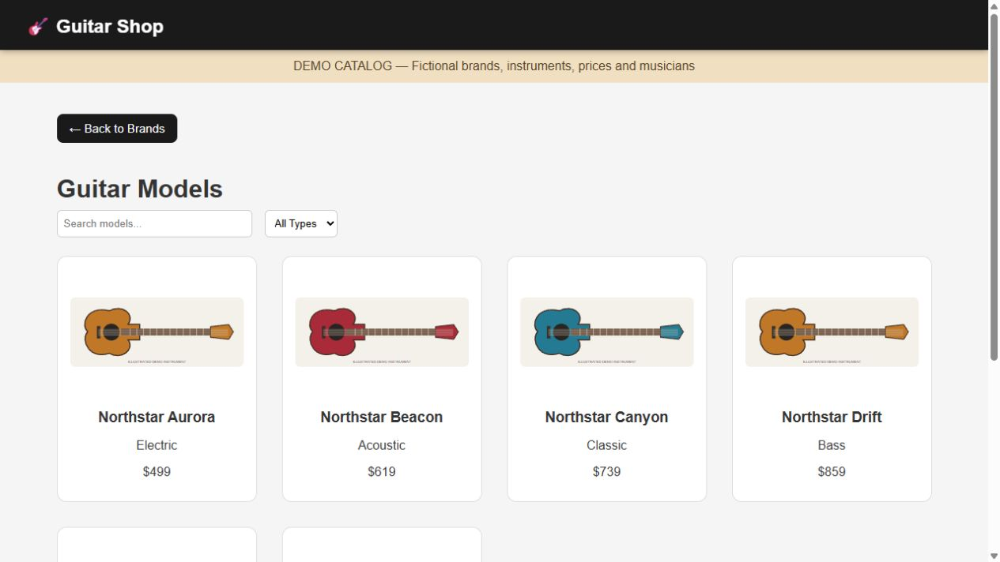
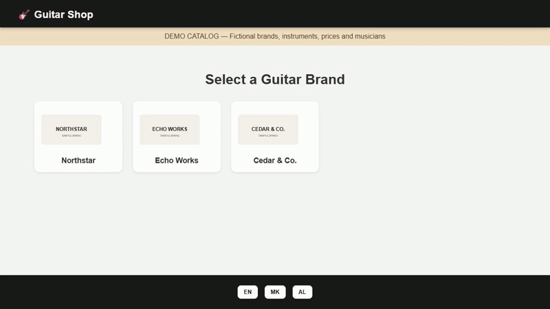
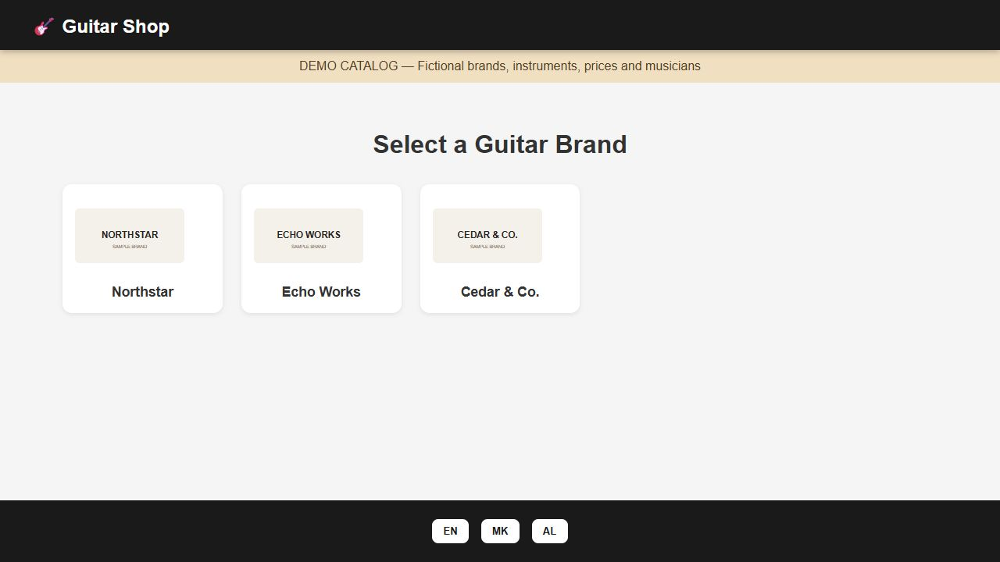
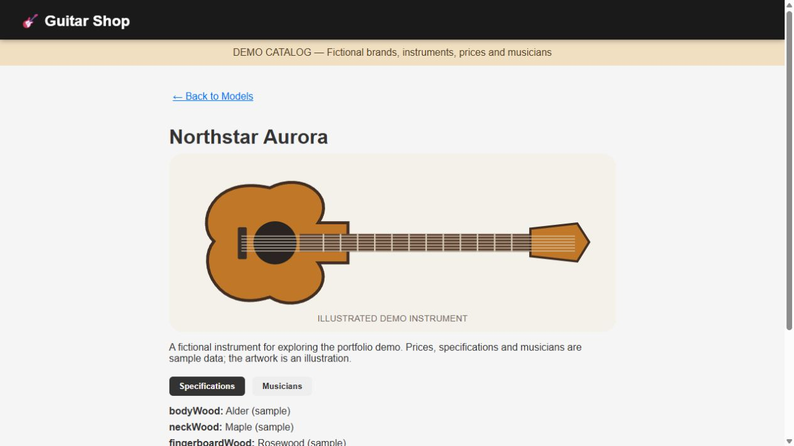
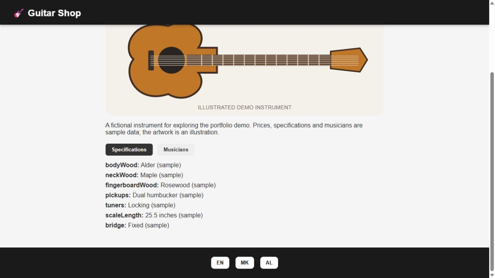
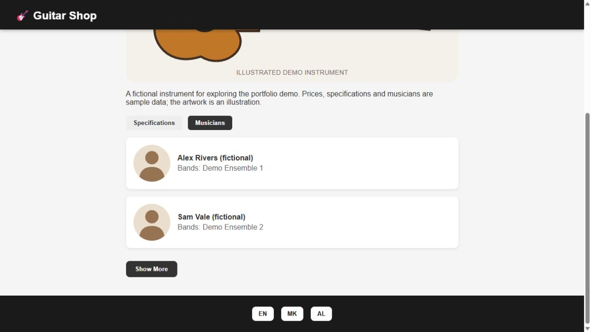
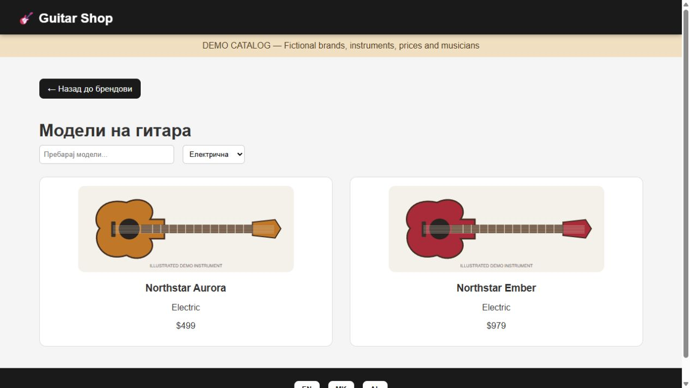

# Guitar Shop

A three-page guitar catalog built with **React, TypeScript, Apollo Client and GraphQL** by **Antonio Puceski**. Browse brands, search and filter instruments, then explore specifications and musicians associated with a model.

Originally created for a Software Engineer Intern assignment with a supplied Figma design reference. This is a catalog browsing frontend; it does not include a cart, checkout, payments or order management.

## Preview



**All portfolio media uses the optional sample catalog.** Brands, instruments, prices, specifications and musicians are fictional. Guitar images are local SVG illustrations, not product photographs. The screenshots show the running application. The 24-second video and GIF are a slideshow of six captured screens, not a continuous interaction recording.



[Watch or download the MP4](docs/media/demo.mp4)

| Brand selection | Instrument details |
| --- | --- |
|  |  |

| Specifications | Musicians |
| --- | --- |
|  |  |



## Features

- Brand selection and nested routes for model lists and details.
- Name search through an Apollo query, combined with client-side type filtering.
- Progressive display of models in batches of six using IntersectionObserver.
- Specifications and Musicians detail tabs, with two musicians initially visible and a Show More control.
- English, Macedonian and Albanian interface controls through i18next.
- Apollo caching, loading states and error messages.
- Keyboard-accessible brand/model cards and labeled type selection.

Translations cover interface controls. Catalog text, specification keys and the demo notice are not fully localized.

## Run the demo

Use a Node.js version compatible with Vite 7 and npm, then:

```bash
git clone https://github.com/AntonioPuceski/Guitar-Shop.git
cd Guitar-Shop
npm ci
```

Copy `.env.example` to `.env`:

```powershell
# Windows PowerShell
Copy-Item .env.example .env
```

On macOS/Linux, use `cp .env.example .env` instead. The example enables:

```dotenv
VITE_DEMO_MODE=true
```

```bash
npm run dev
```

Open the local URL printed by Vite. The demo contains three sample brands with eight models each, four instrument types and fictional musician profiles. It uses a local Apollo Link with bundled data and artwork, so the catalog needs no API account or external image service.

## Live GraphQL configuration

The original endpoint, `https://graphql-api-brown.vercel.app/api/graphql`, returned **DEPLOYMENT_NOT_FOUND** when checked on October 21, 2026. Live catalog operation could not be verified.

To connect a replacement service with the same schema, set:

```dotenv
VITE_DEMO_MODE=false
VITE_GRAPHQL_URL=https://your-service.example/api/graphql
```

Restart Vite after environment changes. The application does not silently substitute demo data when a live request fails. Vite variables are public client configuration; do not put private credentials in them.

The expected GraphQL fields are `findAllBrands`, `findBrandModels`, `searchModels` and `findUniqueModel`; their selections and variables are defined in the page components. The replacement service must support browser requests from your frontend origin.

## Architecture

```text
React Router pages -> Apollo Client + cache
                       |-- HTTP link -> compatible GraphQL service
                       `-- Demo link -> local fictional catalog

Styled Components -> layout and cards
i18next -> translated interface controls
```

| Path | Responsibility |
| --- | --- |
| `src/pages/BrandListPage.tsx` | Brand query and navigation |
| `src/pages/ModelListPage.tsx` | Search, type filtering and progressive rendering |
| `src/pages/ModelDetailsPage.tsx` | Specification and musician views |
| `src/apollo/client.ts` | Live/demo data transport selection |
| `src/demo/catalog.ts` | Fictional sample catalog |
| `src/i18n.ts` | English, Macedonian and Albanian control labels |
| `public/demo/` | Local illustrative artwork |
| `docs/media/` | Captured images, GIF and MP4 |

The active pages use Styled Components. CSS Modules and other starter styling files remain in the repository from development.

## Validation

```bash
npm run lint
npm run build
npm run preview
```

Lint passed, and production builds passed with both live configuration and demo mode. Browser checks in demo mode covered navigation, combined search/type filtering, progressive loading from six to eight models, both detail tabs, Show More and all three interface languages. The MP4 was decoded successfully after generation. A successful live-config build does not establish that the unavailable backend works.

The portfolio update also keeps the search input mounted during search requests, normalizes whitespace in searches, handles a missing model without crashing, and excludes Apollo's internal `__typename` field from specifications.

## Scope and next improvements

This project demonstrates routed UI composition, GraphQL query integration, filtering and internationalization. It remains an assignment-scale frontend.

- Restore or replace the live catalog service and verify its schema and responses.
- The existing dependency lockfile reported 26 audit advisories (1 low, 3 moderate and 22 high) during this update. These remain unresolved and need a tested dependency upgrade before production use.
- Vite reports a bundle slightly above its 500 kB warning threshold; route splitting would be a useful improvement.
- Add explicit empty-result views, debounce search requests and improve recovery messages.
- Complete content localization and test across mobile browsers and assistive technology.
- The current scrolling behavior reveals an already fetched list; it is not server-side pagination.

## Design reference

The original assignment references this [Figma design](https://www.figma.com/design/Q9sgkZlKkPIkiX3eRSKCJP/Design-Task?node-id=1-2). The portfolio update preserves the application's layout and does not claim pixel-perfect design compliance. Demo SVGs were added specifically as clearly identified illustrative assets.
